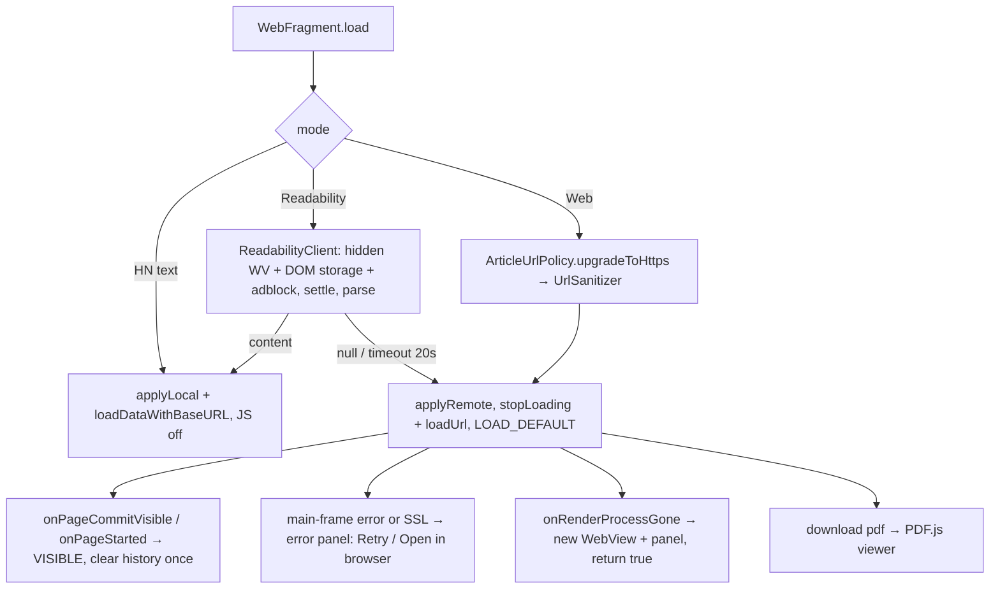

# Material HN — Article Tab Loading Rework Implementation Plan

> **Status:** planned, not started. Approach B approved by the owner on 2026-11-26; the
> remaining design calls below were delegated to the planner ("think rest yourself").

> **For agentic workers:** REQUIRED SUB-SKILL: Use superpowers:subagent-driven-development
> (recommended) or superpowers:executing-plans to implement this plan task-by-task. Steps use
> checkbox (`- [ ]`) syntax for tracking. Re-read this file after any context compaction.

**Goal:** Websites opened in the article tab of the item view render completely and correctly,
never hang on a hidden or frozen WebView, and fail into a recoverable state instead of a raw
Chromium error page or an app crash.

**Reported symptoms (owner, 2026-11-26):** broken layout, page stuck loading, incomplete page.

**Architecture:** Keep the in-app `WebFragment` article tab and the comments/article swipe in
`ItemActivity` / `BaseListActivity`. Rework how the live page is hosted and loaded: the WebView
owns its own scrolling (no outer `NestedScrollView`), settings come from one policy class, load
and visibility are driven by WebView commit callbacks instead of exact URL matching, lifecycle is
per-WebView, errors and renderer crashes are handled in-tab, the ad blocker never touches the main
frame, Readability waits for the page to settle, and web content follows the dark theme through
`androidx.webkit`.

**Tech stack:** AGP 9.2.1, Gradle 9.7.1, JDK 21, Kotlin 2.3.21 / KSP 2.3.8, Java + Kotlin,
Dagger 2, RxJava 3, Robolectric 4.16.1, `androidx.webkit` (new, latest stable — 1.18.0 at the
time of research).

---

## 1. Current pipeline (as of 2026-11-26)

All paths are under `app/src/main/java/in/rahulja/materialhn/` unless noted. Line numbers are
approximate; re-check before editing.

### 1.1 Hosting and lifecycle

- `ItemActivity.onItemLoaded` builds `ItemPagerAdapter` (a `FragmentStateAdapter`) with
  `setShowArticle(hasText || !mExternalBrowser)` and `ViewPager2.setOffscreenPageLimit(2)`
  (`ItemActivity.java` ~535-544). Multi-pane uses `BaseListActivity.bindViewPager` (~596-603).
- Position 0 is `ItemFragment` (comments), position 1 is `WebFragment` (article)
  (`ItemPagerAdapter.java` ~79-95). `EXTRA_EAGER_LOAD` is true only for the default tab.
- `LazyLoadFragment`: eager when `EXTRA_EAGER_LOAD || !Preferences.shouldLazyLoad()`
  (lazy-load defaults to true). `ItemActivity.onPageSelected` and
  `BaseListActivity.updateFabState` call `loadNow()`.
- With an off-screen limit of 2 the `WebFragment` and its WebView always exist; the URL loads only
  when the tab is shown unless lazy-load is off or Article is the default view.
- No WebView is retained across fragments; `WebFragment.onDestroyView` destroys it
  (`WebFragment.java` ~269-305). `onSaveInstanceState` keeps `mContent`, `mReadability`,
  `mEmpty`, fullscreen and the item, but not WebView state, so the page reloads after recreation.

### 1.2 Mode selection — `WebFragment.load()` (~376-393)

1. `mWebView.setVisibility(INVISIBLE)`.
2. `mIsHackerNewsUrl` (Ask HN, jobs, polls) → `bindContent()` → `loadContent()`.
3. `mReadability && !mEmpty` → `parse()` (no cached content) or `loadContent()`.
4. Otherwise `loadUrl()` → `setWebSettings(true)` → `reloadUrl(url)` →
   `UrlSanitizer.sanitizeUrl` → `MaterialWebView.reloadUrl`.

`setWebSettings(isRemote)` (~660-672) also overwrites `mReadability = !isRemote`, a hidden side
effect.

### 1.3 Load mechanics — `widget/MaterialWebView.java`

- `reloadUrl(url)`: `stopLoading()` if progress < 100, store `mPendingUrl`, load `about:blank`.
  `HistoryWebViewClient.onPageFinished(about:blank)` then calls `loadUrl(mPendingUrl)` or
  `loadDataWithBaseURL("file:///", html, ...)` for `reloadHtml`.
- `onPageStarted` sets the view `VISIBLE` **only if** `AppUtils.urlEquals(url, mPendingUrl)`
  (exact string compare plus trailing slash, `AppUtils.java` ~962-969).
- `onPageFinished` with `url == mPendingUrl` clears `mPendingUrl` and history.
- `canGoBack()` is false while `mPendingUrl` is non-empty.
- `shouldOverrideUrlLoading`: http/https load inline; `mailto`, `tel`, `sms`, `market` and the app
  scheme go to `ACTION_VIEW`; everything else (`intent:`, `javascript:`, `file:`, `content:`,
  `data:`, custom schemes) is blocked. Enforced by `WebNavigationSecurityTest`.

### 1.4 Settings — `widget/CacheableWebView.java` (~104-121) and `WebFragment`

Set today:
- `setAllowFileAccess(false)`, `setAllowContentAccess(false)`.
- `setCacheMode(LOAD_CACHE_ELSE_NETWORK)`, re-applied on every load.
- `setLoadWithOverviewMode(true)`, `setUseWideViewPort(true)`, `setJavaScriptEnabled(true)`.
- `WebFragment.setWebSettings`: background white (remote) or transparent (local); overview mode,
  wide viewport and JS follow `isRemote`.
- Zoom off outside fullscreen (`AppUtils.toggleWebViewZoom`).
- PDF path: `setInitialScale(1)`, never reset.

Never set: DOM storage, database, third-party cookies, mixed-content mode, text zoom, algorithmic
darkening, `setSupportMultipleWindows`, media gesture. `androidx.webkit` is not a dependency.

### 1.5 Clients

- `WebFragment.setUpWebView` (~571-624) installs an anonymous `AdBlockWebViewClient` that only
  overrides `onPageStarted`, `onPageFinished`, `doUpdateVisitedHistory`.
- **No** `onReceivedError`, `onReceivedHttpError`, `onReceivedSslError` or
  `onRenderProcessGone` anywhere in the chain.
- `widget/AdBlockWebViewClient.java` (~37-50): `AdBlocker.isAd(url)` on **every** request
  including the main frame; blocked → empty `text/plain`. Caches results in a plain `HashMap`
  written from several WebView IO threads; `mLoadedUrls.get(url)` auto-unboxing can NPE.
- `CacheableWebView.ArchiveClient.onProgressChanged` (~189-200) calls `saveWebArchive` on the main
  thread the first time progress hits 100.
- Download listener: exact `application/pdf` → PDF.js, otherwise `offerExternalApp()`.
  `offerExternalApp()` (~626-650) uses `getActivity().findViewById` for `R.id.empty` and
  `R.id.download_button`, which can hit the wrong fragment in a pager.

### 1.6 Lifecycle

- `onResume` → `mWebView.onResume()` + `resumeTimers()`.
- `onPause` → only disables the back callback; the WebView itself is not paused.
- `onStop` → `pauseWebView()` → `onPause()` + **`pauseTimers()`** (~472-476). `pauseTimers` is
  process-global: it pauses layout, parsing and JS timers for all WebViews. Activity order
  A.onPause → B.onResume → A.onStop means opening a second item freezes its article and any
  hidden Readability WebView.

### 1.7 Layout — `app/src/main/res/layout/fragment_web.xml`

`FrameLayout` > `NestedScrollView`(wrap_content) > `LinearLayout#scroll_view_content` >
`include toolbar_web` + `FrameLayout#web_view_container`(0dp, weight 1) >
`CacheableWebView#web_view` (**`layout_height="wrap_content"`**) + `ViewStub#empty`.
A sibling `FrameLayout#fullscreen` receives the content in fullscreen with `MATCH_PARENT`.

The WebView sizes to the full document height and the outer scroll view scrolls it. Consequences:
`100vh` sections, `position: fixed/sticky`, IntersectionObserver lazy loading and infinite scroll
misbehave (the whole document is "in view"), and very tall pages cost a lot of tile memory.

`activity_item.xml` is a `CoordinatorLayout` with an `AppBarLayout` (`@id/appbar`) whose toolbar,
header card and tab layout use `scroll|enterAlwaysCollapsed` / `scroll|snap|enterAlways`, so the
app bar currently hides via nested scrolling from the `NestedScrollView`.

### 1.8 Network security

`app/src/main/res/xml/network_security_config.xml` sets
`<base-config cleartextTrafficPermitted="false">`. WebView honours it, so `http://` articles,
http redirect hops and http subresources fail with `net::ERR_CLEARTEXT_NOT_PERMITTED`. Nothing
upgrades to https or offers a fallback.

### 1.9 Readability — `data/ReadabilityClient.java` (~119-270)

- `parse()` → Room cache, else `fromNetwork()`: a hidden `new WebView(context)` loads the URL a
  second time (JS on, images blocked, file/content/geolocation off, **no DOM storage, no ad
  blocker**).
- On the first `onPageFinished` it evaluates `Readability.js` and emits `json.content`; often
  before SPA content exists.
- Main-frame errors complete empty; overall timeout 30 s. Meanwhile the article WebView is
  INVISIBLE with progress at 20.
- `WebFragment.onParsed`: null → `mEmpty = true`, toast, `loadUrl()`.
- Rendering: `loadContent()` → JS off → `AppUtils.wrapHtml` (`R.string.html` template in
  `res/values/non_translatable.xml` ~39-63) with base URL `file:///`. http images are blocked by
  the cleartext ban.

### 1.10 Other consumers of the same widgets (must keep working)

- `data/SyncDelegate.java` (~279-295) and `data/WebCacheService.java` (~50-61): background
  pre-cache with `CacheableWebView` + `AdBlockWebViewClient` + `ArchiveClient` (`.mht` archives).
- `OfflineWebActivity.java`: opens archived pages with `AdBlockWebViewClient` + `ArchiveClient`.
- PDF.js: `assets/pdf/index.html` + `PdfAndroidJavascriptBridge` (cache-confined, 10 MB chunks).

### 1.11 Tests that constrain the redesign

- `WebFragmentSecurityTest`: `loadContent()` → JS off; `load()` for remote → JS on.
- `WebFragmentTest`: fullscreen toggle, PDF bridge chunk reads and cache confinement,
  `isCurrentPage`, `onDestroyView` cleanup, null chrome client / empty URL handling, back callback
  enablement.
- `widget/CacheableWebViewTest`: file and content access off.
- `widget/WebNavigationSecurityTest.kt`: scheme allowlist, `FileDownloader.confineToCache`.
- `AdBlockerTest`, `UrlSanitizerTest.kt`.

---

## 2. Root causes mapped to symptoms

| # | Cause | Evidence | Symptom |
|---|-------|----------|---------|
| 1 | WebView is `wrap_content` inside `NestedScrollView` | `fragment_web.xml` ~24-63 | Broken layout, incomplete page (lazy images, infinite scroll), memory on long pages |
| 2 | Visibility gated on exact URL match | `WebFragment.load` sets INVISIBLE; `MaterialWebView` `onPageStarted` + `AppUtils.urlEquals` | Stuck loading / blank tab after redirect or URL normalisation |
| 3 | `about:blank` two-step reload depends on `onPageFinished` | `MaterialWebView.reloadUrl` | Stuck loading when `onPageFinished` is late or missing (Chromium issue 41471185) |
| 4 | Global `pauseTimers()` in `onStop` | `WebFragment.pauseWebView` | Stuck loading after opening a second item; Readability hangs |
| 5 | DOM storage off | never set | Broken layout / incomplete page on SPAs and consent banners (`localStorage` null) |
| 6 | `LOAD_CACHE_ELSE_NETWORK` always | `CacheableWebView.setCacheModeInternal` | Broken layout from stale HTML vs new hashed assets; refresh doesn't refresh |
| 7 | Ad blocker blocks main frame; non-thread-safe map | `AdBlockWebViewClient` | Blank page on listed hosts; rare background NPE |
| 8 | No error, SSL or renderer-gone handling | absent | Raw error pages; renderer crash kills the app |
| 9 | Cleartext banned, no https upgrade | `network_security_config.xml` | http articles and http images fail |
| 10 | Readability parses on first `onPageFinished`, no DOM storage | `ReadabilityClient.fromNetwork` | Incomplete reader text; long hidden spinner (30 s) |
| 11 | Pager steals horizontal gestures; zoom only in fullscreen | `ItemActivity.setFullscreen` toggles `setUserInputEnabled` only in fullscreen | Wide content / zoomed pages unusable |
| 12 | Remote background forced white, no algorithmic darkening | `WebFragment.setWebSettings` | White flash / white pages in dark themes |

---

## 3. Research notes (2026-11-26)

- WebView inside `NestedScrollView` renders with wrong height; Google advises against
  CoordinatorLayout collapsing with WebView —
  https://issuetracker.google.com/issues/37077954 . WebView cannot expose nested scrolling —
  https://issuetracker.google.com/issues/148731508 . Community `NestedScrollWebView` pattern:
  https://github.com/Telefonica/android-nested-scroll-webview .
- `androidx.webkit` latest stable 1.18.0 (2026-10-21); 1.19.0-alpha02 is alpha. API is
  `WebSettingsCompat.setAlgorithmicDarkeningAllowed` (1.5.0+, targetSdk ≥ 33, WebView 105+).
  `addDocumentStartJavaScript` (1.9.0+). Lint warns on a custom `WebViewClient` without
  `onRenderProcessGone` since 1.17.0 —
  https://developer.android.com/jetpack/androidx/releases/webkit .
- `onRenderProcessGone`: return `true`, destroy the dead WebView, recreate if needed —
  https://developer.android.com/develop/ui/views/layout/webapps/handle-termination .
- `pauseTimers()` "pauses all layout, parsing, and JavaScript timers for all WebViews" —
  https://developer.android.com/reference/android/webkit/WebView . Use per-view `onPause`/`onResume`.
- `onPageCommitVisible` fires when previous content is no longer drawn; use it as the "page
  visible" signal. `onPageFinished` is unreliable on some pages —
  https://issues.chromium.org/41471185 .
- `WebSettings` defaults: `domStorageEnabled=false`, `cacheMode=LOAD_DEFAULT`,
  mixed content `NEVER_ALLOW` — https://developer.android.com/reference/android/webkit/WebSettings .
- Cleartext blocked by default since Android 9; network security config applies to WebView
  (`ERR_CLEARTEXT_NOT_PERMITTED`) —
  https://developer.android.com/privacy-and-security/risks/cleartext-communications .
- ViewPager2 + scrollable child: `requestDisallowInterceptTouchEvent(true)` while the child
  consumes horizontal movement —
  https://medium.com/@nasrabadiam/support-nested-scrollable-elements-inside-viewpager2-59fa34978899 .
- Readability.js — https://github.com/mozilla/readability . No authoritative timing guidance
  found; settle-polling is this plan's call.

Unverified on device (check during Task 11): whether `onPageStarted` reports the post-redirect URL
for server 301/302 on current WebView; SPA `pushState` callback behaviour.

---

## 4. Decisions

### 4.1 Approaches considered

| Approach | Summary | Trade-off | Verdict |
|----------|---------|-----------|---------|
| A. Patch in place | Settings, lifecycle, visibility, errors, ad blocker; keep wrap_content layout | Smallest diff; broken layouts largely remain | Rejected |
| **B. Rework live-page loading** | A + WebView owns scrolling, androidx.webkit, error panel, gesture handling, Readability settle | Medium diff; app-bar hiding needs a replacement mechanism | **Chosen by owner** |
| C. Custom Tabs for live pages | Chrome renders; reader/HN text/PDF stay in-app | Loses swipe between comments and article, ad blocking, find-in-page | Rejected |

### 4.2 Calls made by the planner (owner may override)

1. **App bar hiding.** WebView is `match_parent` and scrolls itself. The fragment listens to the
   WebView's scroll and calls `AppBarLayout.setExpanded(false/true, true)` past a threshold.
   Chosen over a `NestedScrollingChild` WebView subclass, which misbehaves on pages that scroll
   inside their own containers and needs expensive resizing for fixed footers.
2. **Horizontal gestures.** The WebView claims a gesture from the pager only when the gesture is
   mostly horizontal **and** `canScrollHorizontally(direction)` is true. Unzoomed, normal pages
   still swipe between tabs.
3. **Pinch zoom** is on outside fullscreen too; on-screen zoom controls stay hidden.
4. **http upgrade.** Main-frame `http://` is rewritten to `https://`. Cleartext stays banned. If
   the https load fails, the error panel offers Open in browser.
5. **Errors.** Main-frame network and SSL failures show an in-tab panel with Retry and Open in
   browser. HTTP 4xx/5xx still render (challenge and paywall pages carry content). SSL errors are
   always cancelled, never proceeded.
6. **Renderer crash.** `onRenderProcessGone` returns `true`, replaces the WebView and shows the
   panel.
7. **Third-party cookies** stay off (privacy, consistent with ad blocking; not a cause of the
   reported symptoms).
8. **Cache.** Online: `LOAD_DEFAULT`. Offline with an `.mht` archive: `LOAD_CACHE_ONLY` + archive
   (unchanged). Offline without archive: `LOAD_CACHE_ELSE_NETWORK`.
9. **Lifecycle.** Per-WebView `onPause()`/`onResume()` tied to the fragment's
   `onPause`/`onResume`. ViewPager2's `FragmentStateAdapter` caps off-screen fragments at
   `STARTED`, so the hidden article tab is paused while the comments tab is shown. No
   `pauseTimers()`/`resumeTimers()`.
10. **Readability.** Keep the hidden WebView (offline pre-parse in `SyncDelegate` needs it). Add
    DOM storage and ad blocking there, https upgrade, settle-polling (400 ms interval, two equal
    readings or 4 s cap), timeout 30 s → 20 s. Add `upgrade-insecure-requests` CSP meta to the
    reader HTML template.
11. **Dark mode.** Add `androidx.webkit`; allow algorithmic darkening when the app theme is dark
    and the feature is supported. Remote background follows the theme's card background colour.
12. **Font preference changes** reload only in Readability / local-content mode, not for live
    pages.

### 4.3 Non-goals

- Changing `UrlSanitizer` rules.
- Changing the `.mht` archive format or the offline sync flow.
- Changing Custom Tabs / external-browser flows or preferences.
- Adding new user-facing settings (dark-mode toggle, cookie toggle, JS toggle).
- Multi-window / `target=_blank` popups, HTML5 video fullscreen, file chooser, permissions.
- Replacing Readability.js with a JVM port.

### 4.4 Anti-goals (failure even if it "works")

- Weakening security: enabling cleartext, file/content access, `intent:` navigation, JS for local
  content, or proceeding on SSL errors.
- Breaking the comments ↔ article swipe for ordinary pages.
- Breaking background pre-caching or offline archive viewing.
- Losing app-bar hiding on scroll.

---

## 5. Target load flow

---

## 6. Global constraints

- `minSdk 31`, `targetSdk 36`, `compileSdk 36`, JDK 21. Do not change.
- One new runtime dependency only: `androidx.webkit` (latest stable at build time; 1.18.0 at
  research). Add to `gradle/libs.versions.toml` `[versions]` and `[libraries]`, reference from
  `app/build.gradle`.
- New code in Kotlin where it is a new file (`package \`in\`.rahulja.materialhn.widget` — escape
  `in`). Edits to existing Java files stay Java.
- Robolectric tests use `@Config(sdk = Build.VERSION_CODES.S)` or newer.
- Conventional Commits, one commit per task.
- Run `./gradlew testDebugUnitTest` before every commit; green is required.
- Keep `WebFragmentSecurityTest`, `WebNavigationSecurityTest`, `CacheableWebViewTest`,
  `AdBlockerTest`, `UrlSanitizerTest` green and meaningful; do not weaken their assertions.
- Do not touch unrelated files; no drive-by refactors.

## 7. Review focus

1. Redirecting article URL (`example.com` → `www.example.com`, shorteners, http → https) — page
   must become visible; back must not return to the pre-redirect blank state.
2. Opening item B's article from item A's article — B must load and run JS.
3. Pages with sticky headers, `100vh` heroes, lazy images, infinite scroll — must render as in
   Chrome.
4. Offline with and without an `.mht` archive — archive opens; otherwise cached copy or error
   panel, never a hang.
5. Renderer crash — app survives, panel shown, Retry works.
6. Comments ↔ article swipe on an unzoomed page — still switches tabs.
7. Volume-key / keyboard scrolling through `KeyDelegate` — still pages the article; app bar
   expands at top.
8. Dark and AMOLED themes — no white flash; reader mode colours unchanged.
9. Readability default view — JS-rendered blog yields full text; failure falls back to live page
   within ~20 s.
10. Security tests — JS off for local content, scheme allowlist intact, SSL never proceeded.

---

## 8. Tasks

### Task 1 — Central WebView settings policy and cache mode

**Objective:** correct remote/local settings in one place; fresh content online.

**Files:**
- Create `widget/WebViewSettingsPolicy.kt`
- Modify `widget/CacheableWebView.java`, `WebFragment.java`
- Test: create `app/src/test/java/in/rahulja/materialhn/widget/WebViewSettingsPolicyTest.kt`;
  extend `widget/CacheableWebViewTest.java`

**Steps:**
- [ ] Create `object WebViewSettingsPolicy` with:
  - `applyRemote(settings: WebSettings)`: `javaScriptEnabled = true`, `domStorageEnabled = true`,
    `useWideViewPort = true`, `loadWithOverviewMode = true`, `setSupportZoom(true)`,
    `builtInZoomControls = true`, `displayZoomControls = false`,
    `allowFileAccess = false`, `allowContentAccess = false`.
  - `applyLocal(settings: WebSettings)`: `javaScriptEnabled = false`,
    `domStorageEnabled = false`, `useWideViewPort = false`, `loadWithOverviewMode = false`,
    same zoom and file/content flags as remote.
- [ ] `CacheableWebView.init()` calls `applyRemote` (it is used for remote loads by
      `SyncDelegate`/`WebCacheService`), keeping file/content access off.
- [ ] Replace `setCacheModeInternal()` with a cache-mode decision in `getCacheableUrl`:
      online → `LOAD_DEFAULT`; offline + archive exists → `LOAD_CACHE_ONLY` and archive URL;
      offline + no archive → `LOAD_CACHE_ELSE_NETWORK`. Pull the decision into a small static
      method (`cacheModeFor(online: Boolean, archiveExists: Boolean)`) so it is unit-testable.
- [ ] `WebFragment.setWebSettings(isRemote)`: call `applyRemote`/`applyLocal`; **remove**
      `mReadability = !isRemote`. Verify every former reliance on that side effect
      (`onParsed` fallback, mode toggle in `onOptionsItemSelected` ~227, `fontEnabled()`), and set
      `mReadability` explicitly where it was implicitly changed.
- [ ] For every non-PDF `reloadUrl`, call `mWebView.setInitialScale(0)` to undo the PDF
      `setInitialScale(1)`.
- [ ] Remove `AppUtils.toggleWebViewZoom(..., false)` from `setUpWebView` and the toggle in
      `setFullscreen` (zoom is now always on, controls hidden). Delete `toggleWebViewZoom` only if
      it has no other callers.

**Tests:**
- `WebViewSettingsPolicyTest`: every flag in both modes.
- `CacheableWebViewTest`: `cacheModeFor` for the three cases; file/content access still off.
- `WebFragmentSecurityTest` unchanged and green.

**Demo:** an SPA that threw on `localStorage` renders; refresh shows new content.

**Commit:** `fix(web): enable DOM storage, default cache mode and central settings policy`

---

### Task 2 — Per-WebView lifecycle

**Objective:** never freeze other WebViews.

**Files:** modify `WebFragment.java`; test `WebFragmentTest.java`.

**Steps:**
- [ ] `onResume`: `mWebView.onResume()` only; remove `resumeTimers()`.
- [ ] `onPause`: keep the back-callback disable; add `mWebView.onPause()`.
- [ ] `onStop`: remove `pauseWebView()`; delete `pauseWebView()`.
- [ ] Grep `pauseTimers|resumeTimers` across `app/src/main`; remove any other article-path
      callers. Leave `OfflineWebActivity` alone unless it calls `pauseTimers`, in which case switch
      it to per-view too.

**Tests:** `WebFragmentTest`: after `onPause`, the shadow WebView reports paused; after
`onResume`, resumed. Assert `pauseTimers` is never called (Robolectric `ShadowWebView` tracks
pause/resume; if it does not track `pauseTimers`, assert via a spy).

**Demo:** open story A's article, then open story B from it; B loads and is interactive.

**Commit:** `fix(web): pause and resume each WebView instead of global timers`

---

### Task 3 — Direct load and commit-driven visibility in `MaterialWebView`

**Objective:** redirects or URL normalisation never leave the page hidden; no `about:blank`
round-trip.

**Files:** modify `widget/MaterialWebView.java`, `widget/CacheableWebView.java` (only if
overrides need adjusting); test create
`app/src/test/java/in/rahulja/materialhn/widget/MaterialWebViewLoadTest.java`.

**Steps:**
- [ ] `reloadUrl(url)`: `stopLoading()`; set `mClearHistoryOnCommit = true`; `loadUrl(url)`.
- [ ] `reloadHtml(html)`: `stopLoading()`; set `mClearHistoryOnCommit = true`;
      `loadDataWithBaseURL(FILE, html, "text/html", "UTF-8", null)`.
- [ ] Remove `mPendingUrl`, `mPendingHtml`, the `about:blank` branch in `onPageFinished` and the
      `AppUtils.urlEquals` gate.
- [ ] In `HistoryWebViewClient`:
  - `onPageCommitVisible(view, url)`: `view.setVisibility(VISIBLE)`; if
    `mClearHistoryOnCommit`, `clearHistory()` and reset the flag; forward to `mClient`.
  - `onPageStarted`: keep `pageUp(true)`; set VISIBLE for any non-blank URL as a fallback;
    forward.
  - `onPageFinished`: if `mClearHistoryOnCommit` is still set, clear history and reset (covers
    pages where commit-visible did not fire); forward.
- [ ] `canGoBack()`: `!mClearHistoryOnCommit && super.canGoBack()`.
- [ ] Confirm `CacheableWebView.reloadUrl`/`loadUrl` still route through `getCacheableUrl` and
      still reset `ArchiveClient.lastProgress`.
- [ ] Check `AppUtils.urlEquals` callers; delete it only if unused.

**Tests:** `MaterialWebViewLoadTest`: call `reloadUrl("https://a.com")`, then drive the client
with `onPageStarted("https://www.a.com/")` and `onPageCommitVisible(...)`; assert VISIBLE and
`canGoBack() == false`. A second case with `reloadHtml`. Existing `WebFragmentTest`
back-callback tests stay green.

**Demo:** a redirecting article shows instead of a blank tab.

**Commit:** `fix(web): show page on commit instead of exact URL match`

---

### Task 4 — WebView fills the page and scrolls itself

**Objective:** fix broken layouts, lazy loading, infinite scroll, tall-page memory.

**Files:** modify `res/layout/fragment_web.xml`, `WebFragment.java`, `KeyDelegate.java`; tests
`WebFragmentTest.java`, create `KeyDelegateWebViewHelperTest.java`.

**Steps:**
- [ ] `fragment_web.xml`: root `FrameLayout` > `LinearLayout#scroll_view_content`
      (`match_parent` × `match_parent`, vertical) > `include toolbar_web` (gone) +
      `FrameLayout#web_view_container` (`match_parent`, 0dp weight 1) >
      `CacheableWebView#web_view` (`match_parent` × `match_parent`) + `ViewStub#empty`
      + `include_web_error` stub (Task 7). Keep `ProgressBar#progress` on top. Remove
      `NestedScrollView#nested_scroll_view` and `FrameLayout#fullscreen`.
- [ ] `WebFragment.setFullscreen(isFullscreen)`: toggle `mControls` visibility and the system UI
      helper; reset find state on exit. Remove re-parenting, `scrollTo` syncing, layout-param
      height changes and the zoom-out loop.
- [ ] Add `KeyDelegate.WebViewHelper implements Scrollable`:
      `scrollToTop()` → `pageUp(true)`; `scrollToNext()` → `canScrollVertically(1) && pageDown(false)`;
      `scrollToPrevious()` → `canScrollVertically(-1) && pageUp(false)`.
- [ ] `WebFragment`: use `WebViewHelper`; remove `mScrollView`, `mFullscreenView` and
      `mScrollViewContent` if unused; update `scrollToTop`/`scrollToNext`/`scrollToPrevious` and
      `onDestroyView` nulling.
- [ ] Delete `KeyDelegate.NestedScrollViewHelper` if it has no other users (grep first).
- [ ] Check `layout-*` qualifiers for other `fragment_web.xml` variants and update them
      identically.

**Tests:** `WebFragmentTest` fullscreen and `onDestroyView` cases updated and green.
`KeyDelegateWebViewHelperTest` with a mocked WebView verifies delegation and boundary returns.

**Demo:** sticky header stays pinned; images load while scrolling; `100vh` hero fits; volume keys
page through the article.

**Commit:** `fix(web): let the article WebView own its scrolling`

---

### Task 5 — App bar follows WebView scroll; pager yields to horizontal page scroll

**Objective:** keep app-bar hiding without nested scrolling; stop the pager stealing sideways
scrolls.

**Files:** create `widget/AppBarScrollSync.kt`, `widget/GestureIntent.kt`; modify
`WebFragment.java`, `widget/MaterialWebView.java`; tests `AppBarScrollSyncTest.kt`,
`GestureIntentTest.kt`.

**Steps:**
- [ ] `AppBarScrollSync(appBar: AppBarLayout?, thresholdPx: Int)` with
      `onScroll(dy: Int, atTop: Boolean)`: accumulate `dy`; past `+threshold` →
      `setExpanded(false, true)`; past `-threshold` or `atTop` → `setExpanded(true, true)`; reset
      the accumulator on direction change. Threshold ≈ `8dp`.
- [ ] `WebFragment.onViewCreated`: find `R.id.appbar` via `requireActivity().findViewById`
      (null-safe; present in `activity_item.xml` and multi-pane `activity_list.xml`); attach
      `mWebView.setOnScrollChangeListener` → `sync.onScroll(scrollY - oldScrollY, scrollY == 0)`.
      Skip while `mFullscreen`. Expand the app bar on each new `load()`.
- [ ] Confirm the activity's `KeyDelegate` app-bar handling still works with `WebViewHelper`
      returning false at the top.
- [ ] `GestureIntent.claimsHorizontal(dx, dy, canScrollLeft, canScrollRight, touchSlop): Boolean`
      — true when `|dx| > touchSlop`, `|dx| > |dy|`, and the WebView can scroll in the direction
      of the gesture (`dx < 0` → right content, `dx > 0` → left content).
- [ ] `MaterialWebView.onTouchEvent`: on `ACTION_DOWN` record x/y and
      `getParent().requestDisallowInterceptTouchEvent(false)`; on `ACTION_MOVE` if
      `claimsHorizontal(...)` → `requestDisallowInterceptTouchEvent(true)`; on `ACTION_UP`/
      `ACTION_CANCEL` release. Always return `super.onTouchEvent`.

**Tests:** `AppBarScrollSyncTest` (mocked `AppBarLayout`): scroll down past threshold collapses,
scroll up expands, reaching top expands, small jitter does nothing, null app bar is safe.
`GestureIntentTest`: vertical gesture, horizontal with no room, horizontal with room both ways,
below slop.

**Demo:** scrolling hides toolbar, header and tabs; scrolling up restores them; zoomed page pans
sideways without switching tabs; unzoomed swipe switches to comments.

**Commit:** `feat(web): sync app bar with article scroll and yield horizontal gestures`

---

### Task 6 — Ad blocker never blocks the main frame; thread-safe

**Objective:** no blank pages from blocklisted article hosts; no races.

**Files:** modify `widget/AdBlockWebViewClient.java`; test create
`app/src/test/java/in/rahulja/materialhn/widget/AdBlockWebViewClientTest.java`.

**Steps:**
- [ ] In `shouldInterceptRequest`, if `!mAdBlockEnabled || request.isForMainFrame()` return
      `super.shouldInterceptRequest(view, request)`.
- [ ] Remove `mLoadedUrls` and its imports; call `AdBlocker.isAd(url)` directly (trie read is
      lock-free and cheap).

**Tests:** mocked `WebResourceRequest`; stub `AdBlocker` with a known host (use the same test
setup as `AdBlockerTest`). Cases: listed host main frame → `null` (not blocked); listed host
subresource → empty resource; disabled → pass-through; unlisted subresource → pass-through.

**Demo:** a link to a blocklisted host opens.

**Commit:** `fix(adblock): never block the main frame and drop the unsafe cache`

---

### Task 7 — https upgrade, error panel, external-app and PDF fixes

**Objective:** no raw Chromium error pages, no dead http articles, correct fallback views.

**Files:** create `widget/ArticleUrlPolicy.kt`, `res/layout/include_web_error.xml`, strings in
`res/values/strings.xml`; modify `WebFragment.java`, `widget/MaterialWebView.java`,
`res/layout/fragment_web.xml`; tests `ArticleUrlPolicyTest.kt`, `WebFragmentTest.java`.

**Steps:**
- [ ] `object ArticleUrlPolicy { fun upgradeToHttps(url: String?): String? }` — case-insensitive
      `http://` → `https://`; everything else unchanged; null-safe.
- [ ] `WebFragment.loadUrl()`: `ArticleUrlPolicy.upgradeToHttps` before `UrlSanitizer`; remember
      `mUpgradedFromHttp`.
- [ ] `HistoryWebViewClient.shouldOverrideUrlLoading` (request variant): for a main-frame
      `http` URL, `view.loadUrl(upgraded)` and return `true`. Keep `isAllowedNavigation` and
      `handleNavigation` semantics unchanged for all other schemes.
- [ ] `include_web_error.xml`: icon, message `TextView#web_error_message`, `Button#web_error_retry`,
      `Button#web_error_open`. Included in `web_view_container` as `gone`. Strings:
      `web_error_generic`, `web_error_ssl`, `web_error_https_only`, `web_error_crashed`, `retry`,
      `open_in_browser` (reuse existing strings if present).
- [ ] In the `WebFragment` client:
  - `onReceivedError(view, request, error)`: if `request.isForMainFrame()` → `showError(...)`
    with `web_error_https_only` when `mUpgradedFromHttp`, else `web_error_generic`.
  - `onReceivedSslError(view, handler, error)`: `handler.cancel()`; `showError(web_error_ssl)`.
  - Do not override `onReceivedHttpError` for display.
- [ ] `showError(msgRes)`: hide WebView, show panel, set progress 100. Retry → hide panel,
      `load()`. Open → `AppUtils.openWebUrlExternal(context, mItem, mItem.getUrl(),
      mCustomTabsDelegate session)` using the existing signature (check it before calling).
- [ ] `offerExternalApp()`: use `mFragmentView.findViewById` for `R.id.empty` and
      `R.id.download_button`.
- [ ] Download listener PDF check: `mimetype` starts with `application/pdf` (case-insensitive),
      or `application/octet-stream` with a URL path ending `.pdf`. Pull into a static
      `isPdf(mimetype, url)` for testing.

**Tests:** `ArticleUrlPolicyTest`: `http://`, `HTTP://`, `https://`, `mailto:`, empty, null.
`WebFragmentTest`: main-frame error shows panel; subresource error does not; Retry hides panel and
reloads; SSL error cancels the handler (mock) and shows panel; `isPdf` cases.
`WebNavigationSecurityTest` unchanged and green.

**Demo:** an `http://` article loads over https; airplane mode shows panel and Retry recovers;
https-less site offers Open in browser.

**Commit:** `feat(web): upgrade http articles and show a recoverable error panel`

---

### Task 8 — Survive renderer crashes

**Objective:** a WebView renderer crash no longer kills the app.

**Files:** modify `WebFragment.java`; test `WebFragmentTest.java`.

**Steps:**
- [ ] Extract client, chrome client, download listener, touch and scroll listener wiring from
      `setUpWebView` into `bindWebView(MaterialWebView)` so it can run on a new instance.
- [ ] Override `onRenderProcessGone(view, detail)` in the fragment's client:
      remove the dead view from `web_view_container`, null out clients, `destroy()`; create
      `new CacheableWebView(requireContext())` with `match_parent` params and id `R.id.web_view`,
      add it at index 0 of the container; `bindWebView`; apply current settings;
      `showError(web_error_crashed)`; return `true`. If the fragment is detached, just destroy and
      return `true`.
- [ ] Re-point any helpers holding the old WebView (`WebViewHelper`, `AppBarScrollSync`, find
      listener).

**Tests:** call the installed client's `onRenderProcessGone` with a mocked
`RenderProcessGoneDetail`; assert return `true`, `mWebView` is a new instance attached to the
container, panel visible, old instance not attached.

**Demo:** in a debug build, `adb shell am` / test hook loading `chrome://crash` shows the panel;
Retry reloads.

**Commit:** `fix(web): recover from WebView renderer crashes`

---

### Task 9 — Readability waits for the page to settle

**Objective:** fewer empty or truncated reader results; faster fallback.

**Files:** modify `data/ReadabilityClient.java`, `res/values/non_translatable.xml`
(`R.string.html`); create `data/SettleTracker.kt`; tests `SettleTrackerTest.kt`,
`AppUtilsTest.java` (extend).

**Steps:**
- [ ] Hidden WebView client extends `AdBlockWebViewClient(Preferences.adBlockEnabled(mContext))`,
      keeping the existing `onReceivedError` overrides; add `onRenderProcessGone` returning
      `true` and completing the emitter.
- [ ] Settings: add `setDomStorageEnabled(true)`; keep images blocked and file/content/geolocation
      off.
- [ ] Load `ArticleUrlPolicy.upgradeToHttps(url)`.
- [ ] `class SettleTracker(intervalMs = 400, maxMs = 4000)` with `fun record(length: Int,
      elapsedMs: Long): Boolean` → true when two consecutive readings are equal and > 0, or
      `elapsedMs >= maxMs`.
- [ ] After `onPageFinished` (first time only), poll
      `evaluateJavascript("document.body ? document.body.innerText.length : 0")` every 400 ms on
      the main handler; when `SettleTracker.record` returns true, run the existing Readability
      script. Cancel pending polls in the emitter's cancellable.
- [ ] Timeout 30 s → 20 s.
- [ ] `R.string.html` template: add
      `<meta http-equiv="Content-Security-Policy" content="upgrade-insecure-requests">` in
      `<head>`.

**Tests:** `SettleTrackerTest`: stable after two equal readings; growing never settles before cap;
cap reached settles; zero length does not count as stable. `AppUtilsTest`: `wrapHtml` output
contains the CSP meta. Existing Readability callers compile.

**Demo:** with Readability as default view, a JS-rendered blog shows full reader text; http images
appear in reader mode.

**Commit:** `fix(readability): wait for page to settle and enable DOM storage`

---

### Task 10 — Dark web content and no reload on font changes

**Objective:** no white pages or flashes in dark/AMOLED themes; no needless reloads.

**Files:** modify `gradle/libs.versions.toml`, `app/build.gradle`, `widget/WebViewSettingsPolicy.kt`,
`WebFragment.java`; tests `WebViewSettingsPolicyTest.kt`, `WebFragmentTest.java`.

**Steps:**
- [ ] Add `webkit = "<latest stable>"` (1.18.0 at research; verify current stable) and
      `androidx-webkit = { module = "androidx.webkit:webkit", version.ref = "webkit" }`;
      `implementation libs.androidx.webkit` in `app/build.gradle`.
- [ ] `WebViewSettingsPolicy.applyRemote(settings, darkTheme: Boolean)`: if
      `WebViewFeature.isFeatureSupported(WebViewFeature.ALGORITHMIC_DARKENING)` →
      `WebSettingsCompat.setAlgorithmicDarkeningAllowed(settings, darkTheme)`. Keep the feature
      check behind a small seam so tests can assert the call.
- [ ] Determine `darkTheme` from the themed context (`android:isLightTheme` via
      `TypedValue`/`MaterialAttributes`). Verify every app theme and `ThemePreference` overlay sets
      `isLightTheme` correctly; fix theme XML only if a dark theme claims light.
- [ ] Remote background: theme `colorCardBackground` (same as `fragment_web.xml` root) instead of
      `Color.WHITE`.
- [ ] `onPreferenceChanged`: call `load()` only when showing Readability or HN text content.

**Tests:** `WebViewSettingsPolicyTest`: dark → darkening allowed, light → not (via seam).
`WebFragmentTest`: font preference change in web mode does not reload; in reader mode it does.

**Demo:** in AMOLED theme a light-only site renders dark with no white flash; changing reader font
size on a live page does not reload it.

**Commit:** `feat(web): algorithmic darkening for dark themes`

---

### Task 11 — Wiring check, docs, full verification

**Objective:** one integrated, documented, green build verified on device.

**Steps:**
- [ ] Re-check `SyncDelegate`, `WebCacheService`, `OfflineWebActivity` still pre-cache and open
      `.mht` archives with the new settings and cache-mode logic.
- [ ] Update `docs/TD.md` and `docs/PRD.md` web-content sections; update the "Web content" line
      in `AGENTS.md` Architecture Notes (DOM storage, androidx.webkit, error panel, per-view
      lifecycle); add a `docs/ROADMAP.md` line if the roadmap tracks this; add a `Changelog.md`
      entry.
- [ ] `./gradlew test lint assembleDebug` (via the `runq` agent). All green; no new lint errors.
- [ ] Device smoke pass (`adb install`, debug build), each in light and AMOLED theme:
  - SPA news site (DOM storage)
  - sticky-header news site and a `100vh` landing page (layout)
  - lazy-image long-form blog and an infinite-scroll page (completeness)
  - `http://`-only link and an http link that upgrades (https upgrade + panel)
  - redirecting link (shortener, apex → www)
  - PDF link (`application/pdf` and `.pdf` with `octet-stream`)
  - airplane mode with and without an offline archive
  - open article from item A, then item B (lifecycle)
  - zoomed wide table / code block (gestures) and normal swipe to comments
  - Readability default view on a JS-rendered blog
- [ ] Record results (pass/fail per site, device, WebView version) in this file under §10.
- [ ] Run the `verify` agent against this plan's requirements before declaring done.

**Commit:** `docs(web): document reworked article loading`

---

## 9. Risks and mitigations

| Risk | Mitigation |
|------|------------|
| App-bar sync feels different from nested scrolling (no partial collapse) | Snap behaviour already used (`scroll|snap|enterAlways` on tabs); threshold tuned on device |
| Pages relying on outer scroll (none known) regress | Device smoke pass; fullscreen previously used `MATCH_PARENT` successfully |
| `LOAD_DEFAULT` increases data use vs cache-first | HTTP caching still applies; offline path unchanged |
| https upgrade breaks a site that only serves http | Error panel with `web_error_https_only` + Open in browser |
| Algorithmic darkening mangles already-dark or image-heavy sites | Darkening only applies to pages without their own dark scheme (WebView respects `prefers-color-scheme` / `color-scheme`) |
| Removing `about:blank` step leaves previous page drawn briefly | View stays INVISIBLE until commit-visible; progress bar shown |
| Robolectric lacks WebView client/feature behaviour | Pure-function seams (`cacheModeFor`, `GestureIntent`, `SettleTracker`, `ArticleUrlPolicy`, `isPdf`, darkening seam) carry the logic tests |
| Renderer recreation leaks references | Single `bindWebView` path; `onDestroyView` already nulls everything; test asserts old view detached |

## 10. Verification log

Host-side verification (2026-11-26):

- `./gradlew test lint assembleDebug` → BUILD SUCCESSFUL; lint 0 errors
  (warnings/hints only).
- Independent review fix pass: aborted-load errors ignored and the panel hidden on
  commit, reader mode disables algorithmic darkening, page-start no longer reveals
  stale content, gesture claimed on ACTION_DOWN, offline archive keeps
  `LOAD_CACHE_ONLY` across the reload resolve, POST navigations not rewritten,
  crash fallback to the dead view's parent, `:80` dropped on upgrade,
  Readability poll cancelled cleanly.
- Hostile self-review pass: no-flash fallback reveal (finish only for the pending
  URL), aborted loads ignored in Readability too, back navigation restored after a
  failed load, PDF download follows the clicked URL, crash path clears the PDF
  bridge, release build (`assembleRelease`, R8 + lintVital) green.
- Unit suites added: `WebViewSettingsPolicyTest`, `MaterialWebViewLoadTest`, `MaterialWebViewTouchTest`,
  `KeyDelegateWebViewHelperTest`, `AppBarScrollSyncTest`, `GestureIntentTest`,
  `AdBlockWebViewClientTest`, `ArticleUrlPolicyTest`, `SettleTrackerTest`;
  extended `CacheableWebViewTest`, `WebFragmentTest`, `AppUtilsTest`.

Device smoke pass: **not run — no device attached to this workstation.**
The table stays for the owner to fill from `adb install` of the debug APK.

| Date | Device / WebView | Theme | Site class | Result | Notes |
|------|------------------|-------|------------|--------|-------|
| — | — | light / AMOLED | SPA news site (DOM storage) | not run | needs device |
| — | — | light / AMOLED | sticky header + `100vh` (layout) | not run | needs device |
| — | — | light / AMOLED | lazy images + infinite scroll | not run | needs device |
| — | — | light / AMOLED | `http://` only + http→https (upgrade/panel) | not run | needs device |
| — | — | light / AMOLED | redirecting link (shortener, apex→www) | not run | needs device |
| — | — | light / AMOLED | PDF (`application/pdf`, `.pdf`/octet-stream) | not run | needs device |
| — | — | light / AMOLED | airplane mode ± offline archive | not run | needs device |
| — | — | light / AMOLED | item A article → item B (lifecycle) | not run | needs device |
| — | — | light / AMOLED | zoomed wide table (gestures) + swipe to comments | not run | needs device |
| — | — | light / AMOLED | Readability default on JS-rendered blog | not run | needs device |
